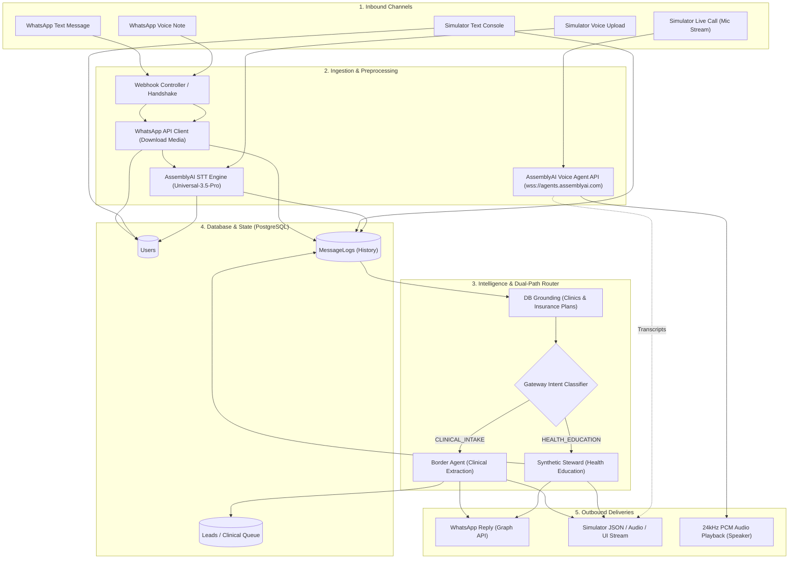
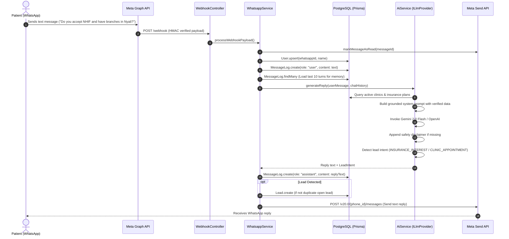
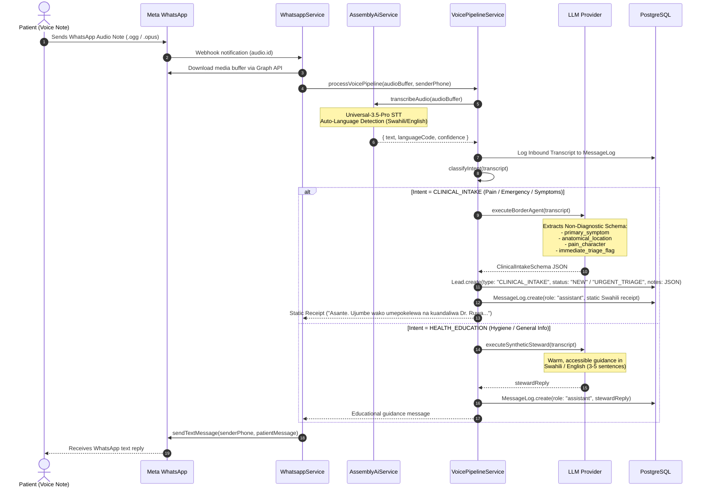
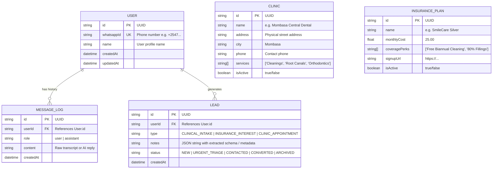

# 🦷 Dr. Papi Foundation / Dental AI Assistant
## Comprehensive Project Architecture & End-to-End Data Flow Specification

> **Presentation & Technical Architecture Guide**  
> *Covering Text, Asynchronous Voice Notes, and Real-Time Full-Duplex Live Voice*

---

## 1. Executive Summary & Project Vision

The **Dental AI Assistant** (developed for the **Dr. Papi Foundation** and dental clinic networks) is an intelligent, multi-modal clinical and educational triage system designed to bridge the accessibility gap in oral healthcare—specifically tailored for community deployments in regions like Mombasa, Kenya, while supporting multilingual interactions (English, Swahili, and conversational Sheng).

### The Core Problem It Solves:
1. **Clinical Triage Bottlenecks:** Patients experiencing acute dental distress (toothaches, swelling, trauma) often delay care or seek unverified home remedies because they lack immediate triage.
2. **Oral Health Literacy Deficits:** General communities often lack accessible, non-intimidating education on preventive oral hygiene (flossing, fluoridation, pediatric care).
3. **Multi-Modal Accessibility:** Many community members prefer sending **voice notes** or speaking on a **live voice call** rather than typing complex text messages.

### The System Solution:
A unified, production-grade backend built with **NestJS**, **Prisma ORM**, **PostgreSQL**, **Meta WhatsApp Cloud API**, **AssemblyAI (Speech-to-Text & Real-Time Voice Agent)**, and a **vendor-agnostic LLM abstraction layer** supporting **Google Gemini 2.0 Flash** and **OpenAI GPT-4o**.

```
                           ┌────────────────────────────────────────┐
                           │            PATIENT INTERFACES          │
                           │  • WhatsApp Messaging (Text / Audio)   │
                           │  • Interactive Playground / Simulator │
                           │  • Real-Time Web Audio Live Calling    │
                           └───────────────────┬────────────────────┘
                                               │
                                               ▼
                           ┌────────────────────────────────────────┐
                           │          NESTJS BACKEND SYSTEM         │
                           │  • Webhook Handshake & Security        │
                           │  • Dual-Path Routing Engine            │
                           │  • Grounded LLM Provider Layer         │
                           │  • AssemblyAI Speech & Voice Token Hub │
                           │  • PostgreSQL / Prisma Persistence     │
                           └───────────────────┬────────────────────┘
                                               │
                     ┌─────────────────────────┴─────────────────────────┐
                     ▼                                                   ▼
       ┌───────────────────────────┐                       ┌───────────────────────────┐
       │     PATH 1: BORDER AGENT  │                       │ PATH 2: SYNTHETIC STEWARD │
       │  Structured JSON Intake,  │                       │ Warm Oral Health Guidance,│
       │  Triage Flagging & Queue  │                       │ Demystification, Safe Info│
       └───────────────────────────┘                       └───────────────────────────┘
```

---

## 2. High-Level Technology Stack

| Layer | Technologies Used | Key Responsibilities |
| :--- | :--- | :--- |
| **Backend Framework** | **NestJS (TypeScript)** | Modular architecture, dependency injection, REST APIs, and lifecycle management. |
| **Database & ORM** | **PostgreSQL + Prisma ORM** | Persistence for Users, Conversation Logs (`MessageLog`), Clinical Leads (`Lead`), Clinics, and Insurance Plans. |
| **Speech-to-Text (STT)** | **AssemblyAI Universal-3.5-Pro** | High-accuracy audio transcription, automatic language identification, punctuation, and formatting. |
| **Real-Time Voice Agent** | **AssemblyAI Voice Agent WebSocket API** | Full-duplex, low-latency live speech input and streamed PCM16 speech output (24 kHz). |
| **LLM Provider Layer** | **Gemini 2.0 Flash (`@google/genai`) / OpenAI (`openai`)** | Grounded clinical intent classification, clinical schema extraction, and educational content generation. |
| **Messaging Channel** | **Meta WhatsApp Cloud API (Graph API v20.0)** | Direct WhatsApp messaging, webhook event ingestion, media downloading, and delivery tracking. |
| **API Documentation** | **Swagger / OpenAPI (`/api/docs`)** | Full interactive documentation for admin and simulator endpoints. |

---

## 3. Data Movement Deep Dives (The 3 Core Modalities)



---

### Modality 1: The Text Flow (Standard WhatsApp & Simulator)

The text flow handles routine user text messages from WhatsApp or the administrative simulator playground.



#### Step-by-Step Data Path:
1. **Webhook Ingestion:** Meta triggers a `POST /webhook` containing an encrypted JSON event with the user's phone number (`wa_id`), message text, and message ID.
2. **Immediate Read Receipt:** The system fires an asynchronous `markMessageAsRead` request back to Meta to show blue checkmarks on the user's phone.
3. **Session & History Resolution:** The system performs a Postgres `upsert` on the `User` table and queries the last **10 message turns** to give the LLM contextual memory.
4. **Real-Time Data Grounding:** `AiService` queries active clinic locations, phone numbers, addresses, and insurance tiers directly from the database and injects them dynamically into the system prompt. This guarantees the model never hallucinates clinic addresses or prices.
5. **Constitutional LLM Inference:** The vendor-agnostic provider (`GeminiProvider` or `OpenAiProvider`) generates a concise, empathetic response.
6. **Safety & Lead Gateways:**
   - Appends the mandatory AI disclaimer footer.
   - Detects commercial or appointment intent and records a deduplicated `Lead` entry for clinic staff follow-up.
7. **Delivery:** The formatted text is dispatched via Meta Graph API v20.0 to the user's device.

---

### Modality 2: The Asynchronous Voice Note Flow (Audio STT + Dual-Path Routing)

When a patient sends a WhatsApp voice note (or uploads an audio file in the simulator), the audio is transcribed via AssemblyAI and processed through the **Dual-Path Architecture**.



#### Dual-Path Architectural Distinction:
* **Path 1: The Border Agent (Clinical Intake & Triage)**
  * **Objective:** Ingest unstructured spoken distress in Swahili, English, or Sheng and convert it into a **strictly non-diagnostic structured JSON clinical report**.
  * **Safety Constraints:** Never diagnoses (e.g., will never write "irreversible pulpitis"), never prescribes medications, and flags severe red flags (`immediate_triage_flag = true` for uncontrolled bleeding, airway compromise, or spreading facial swelling).
  * **Patient Output:** Sends a deterministic, reassuring Swahili receipt acknowledging reception for **Dr. Ruwa** and clinic triage.
  * **Data Storage:** Persisted to the `Lead` table with status `NEW` or `URGENT_TRIAGE`, immediately visible in the Clinical Queue.

* **Path 2: The Synthetic Steward (Health Education)**
  * **Objective:** Answer community questions on brushing techniques, teething, bleeding gums, fluoride, or dietary impact.
  * **Tone:** Plain-spoken, empathetic, culturally grounded in Mombasa/Kenyan vernacular.
  * **Safety Constraints:** If the user starts describing acute personal pain, the Steward gracefully explains the concept and directs them to submit a voice note for Dr. Ruwa's clinical assessment.

---

### Modality 3: The Live Voice Flow (Full-Duplex Real-Time Voice Agent API)

The live voice flow enables interactive, bidirectional, low-latency phone-call style conversations directly from a web browser or mobile client using the **official AssemblyAI Voice Agent API**.

```mermaid
sequenceDiagram
    autonumber
    actor User as Patient / User (Mic & Speaker)
    participant Browser as Client Browser (Web Audio API)
    participant Backend as NestJS Simulator Controller
    participant AAI_Auth as AssemblyAI Token API (REST)
    participant AAI_WS as AssemblyAI Voice Agent (WebSocket)

    User->>Browser: Clicks "Start Live Phone Call"
    Browser->>Backend: GET /api/v1/simulator/voice-agent-token
    Backend->>AAI_Auth: GET /v1/token (with server-side ASSEMBLY_AI_API_KEY)
    AAI_Auth-->>Backend: Return temporary single-use token (TTL: 300s)
    Backend-->>Browser: { token: "jwt_temp_token..." }
    
    Browser->>AAI_WS: WebSocket Handshake (wss://agents.assemblyai.com/v1/ws?token=...)
    AAI_WS-->>Browser: Connection Accepted (HTTP 101 Switching Protocols)
    
    Browser->>AAI_WS: send(session.update) -> System Prompt, Voice ('anna'), 24kHz PCM Format
    AAI_WS-->>Browser: { type: "session.ready", session_id: "..." }
    
    rect rgb(20, 35, 60)
        Note over Browser,AAI_WS: Full-Duplex Real-Time Voice Loop
        User->>Browser: Speaks into Microphone
        Browser->>Browser: AudioContext (24kHz) -> Float32 to Int16 PCM Chunks
        Browser->>AAI_WS: Binary PCM Audio Stream (continuous)
        
        AAI_WS-->>Browser: { type: "transcript.user.delta", text: "I have pain..." }
        AAI_WS-->>Browser: { type: "transcript.user", text: "I have pain in my lower molar." }
        AAI_WS-->>Browser: { type: "reply.started" }
        AAI_WS-->>Browser: { type: "reply.audio", data: "base64_pcm16_chunk..." }
        Browser->>User: Plays synthesized voice via Web Audio API speaker buffer
        AAI_WS-->>Browser: { type: "transcript.agent", text: "I'm sorry to hear that. How long has it been hurting?" }
        AAI_WS-->>Browser: { type: "reply.done" }
    end

    User->>Browser: Clicks "End Call"
    Browser->>AAI_WS: Close WebSocket
    Browser->>Browser: Teardown AudioContext & MediaStream
```



#### Technical Breakdown of the Live Voice Pipeline:
1. **Secure Token Minting (Zero Exposed Secrets):**
   - The frontend browser never has access to the master `ASSEMBLY_AI_API_KEY`.
   - The client invokes `GET /api/v1/simulator/voice-agent-token`, and the NestJS backend securely mints a short-lived, single-use session token via `https://agents.assemblyai.com/v1/token`.
2. **Direct Low-Latency WebSocket Handshake:**
   - The browser opens a persistent duplex connection directly to `wss://agents.assemblyai.com/v1/ws?token=...`.
3. **Session Configuration Handshake:**
   - As soon as the socket opens, the client sends a `session.update` payload containing the system instructions (Dr. Papi dental persona, non-diagnostic constraints), opening greeting, selected voice model (`anna`), and audio output encoding (`audio/pcm`).
4. **Full-Duplex Audio Pipeline:**
   - **Upstream (Microphone to Agent):** Captures microphone input at **24,000 Hz**, normalizes `Float32` samples to 16-bit linear PCM byte buffers, and streams raw audio packets over the WebSocket.
   - **Downstream (Agent to Speaker):** Receives base64-encoded PCM16 audio frames, decodes them into an `AudioBuffer`, and schedules them sequentially on the `AudioContext` timeline for glitch-free, uninterrupted real-time speech playback.
5. **Real-Time Visual Feedback:**
   - Emits intermediate deltas (`transcript.user.delta`), final user transcripts (`transcript.user`), and streaming agent thoughts (`transcript.agent`) to render live conversational speech bubbles in the UI.

---

## 4. AI Safety & Constitutional Boundaries

To prevent medical liability, hallucination, or inaccurate advice, the system implements **strict constitutional guardrails**:

```
                              ┌───────────────────────────────────┐
                              │     CONSTITUTIONAL GUARDRAILS     │
                              └─────────────────┬─────────────────┘
                                                │
         ┌──────────────────────────────┬───────┴──────────────────────┬──────────────────────────────┐
         ▼                              ▼                              ▼                              ▼
┌──────────────────┐          ┌──────────────────┐          ┌──────────────────┐          ┌──────────────────┐
│ 1. NO DIAGNOSIS  │          │2. NO PRESCRIPTIONS│         │ 3. MANDATORY     │          │ 4. EMERGENCY     │
│ Never name       │          │ Never recommend  │          │    DISCLAIMER    │          │    TRIAGE FLAG   │
│ specific diseases│          │ drug names or    │          │ Appended to      │          │ Escalates airway/│
│ or pulp pathology│          │ dosages          │          │ all outbound     │          │ bleeding issues  │
│                  │          │                  │          │ messages         │          │ to clinicians    │
└──────────────────┘          └──────────────────┘          └──────────────────┘          └──────────────────┘
```

### The Extracted Clinical Schema (`BorderAgent`)
When acute symptoms are received, the LLM parses the message into this exact structure:
```json
{
  "primary_symptom": "Throbbing lower molar pain aggravated by cold liquids",
  "patient_verbatim_quote": "Jino langu la chini linauma sana nikikunywa maji baridi tangu jana usiku",
  "anatomical_location": "lower jaw, left posterior molar region",
  "duration_and_onset": "Started yesterday night (~18 hours ago), sudden onset",
  "pain_character": "throbbing, severe, cold-sensitive",
  "functional_impact": "unable to chew on the left side or sleep comfortably",
  "previous_interventions": "took 1 panadol tablet with minimal relief",
  "immediate_triage_flag": false,
  "confidence_score": 0.96
}
```

---

## 5. Database Schema & Data Models

The system uses PostgreSQL managed through Prisma (`prisma/schema.prisma`):



---

## 6. Vendor-Agnostic LLM Abstraction Layer

The system adheres to the **Dependency Inversion Principle**. Business logic depends on an abstract interface (`ILlmProvider`), allowing runtime swapping of LLM vendors via `.env` without modifying a single line of application code:

```typescript
export interface ILlmProvider {
  generateCompletion(options: CompletionOptions): Promise<string>;
}
```

* **Default Provider:** `GeminiProvider` utilizing Google's `@google/genai` SDK (`gemini-2.0-flash`).
* **Drop-in Swap:** `OpenAiProvider` utilizing the official `openai` SDK (`gpt-4o`).
* **Switching Mechanism:** Simply toggle `LLM_PROVIDER_NAME=gemini` or `LLM_PROVIDER_NAME=openai` in `.env`.

---

## 7. Interactive Simulator & Clinical Queue

The application includes a built-in testing console and clinical review dashboard accessible via `/playground` or REST endpoints:

* **Live Phone Call Simulator:** Experience real-time speech-in and speech-out calling with visual speaking avatars and streaming transcripts.
* **Audio Voice Note Simulator:** Record from microphone or upload `.ogg`/`.wav`/`.mp3` files to test AssemblyAI transcription and the Dual-Path router.
* **Text Chat Simulator:** Submit direct text messages to inspect grounding and disclaimer injection.
* **Live Clinical Queue:** Inspect real-time submissions extracted by the Border Agent, complete with triage urgency badges and verbatim patient quotes.

---

## 8. Summary of Endpoints

| Method | Endpoint | Description |
| :--- | :--- | :--- |
| `GET` | `/webhook` | Meta WhatsApp webhook verification handshake. |
| `POST` | `/webhook` | Inbound WhatsApp event receiver (messages, audio notes, read receipts). |
| `GET` | `/playground` | Interactive Dr. Papi Foundation Voice & Clinical Console UI. |
| `GET` | `/api/v1/simulator/voice-agent-token` | Mints temporary AssemblyAI Voice Agent WebSocket token. |
| `GET` | `/api/v1/simulator/realtime-token` | Mints temporary AssemblyAI STT streaming token. |
| `POST` | `/api/v1/simulator/voice-note` | Accepts multipart audio upload for STT and dual-path execution. |
| `POST` | `/api/v1/simulator/live-turn` | Processes a live conversational text turn through the pipeline. |
| `GET` | `/api/v1/simulator/clinical-queue` | Returns structured clinical intake leads for clinician review. |
| `GET` | `/api/docs` | Swagger OpenAPI specification. |

---

*Authored for the Dr. Papi Foundation & Dental AI Assistant Project Presentation.*
